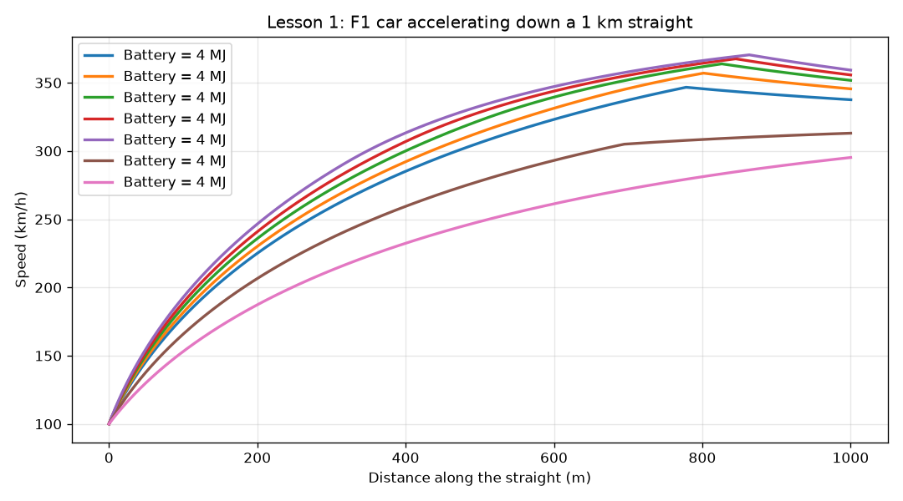
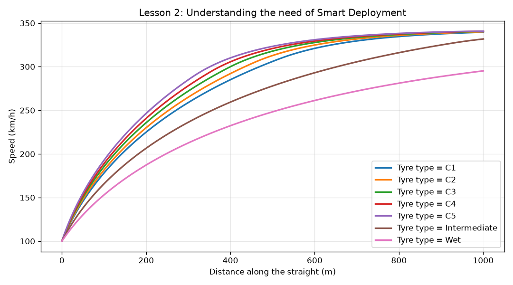

# Virtual 2026 F1 Power Unit

A physics-based simulation of a 2026 Formula 1 power unit (combustion engine + MGU-K electric motor + battery), built to study **energy deployment** and **"clipping"** under the new 2026 regulations, and to compare the 2026, 2027 and 2028 rule sets.

All car and rule values come from the **FIA Formula 1 Technical Regulations** (2026 Section C Issue 21, 2027 Section C Issue 04), are derived from them, are calibrated against real 2026 data, or are clearly labelled as estimates in [`params.py`](params.py).

---

## Why this project

In 2026, F1 cars get roughly **half their power from electricity**: a ~400 kW engine plus a 350 kW MGU-K. But the battery can only hold **4 MJ** of usable energy, so cars spend energy faster than they can recharge it. When the battery runs dry on a straight, the car loses a big chunk of power at full throttle. That's **clipping**, and it became one of the most-discussed problems of the 2026 season.

This project rebuilds that problem from first principles and asks: **where should the energy be spent, and how do the rules change the answer?**

---

## Lesson 1: Straight-line simulation and clipping

`lesson1_straight_line.py` simulates a car accelerating down a 1 km straight using Newton's 2nd law and Euler integration (small time steps). When the battery empties, the MGU-K switches off and the car falls back to engine power only.



**Findings**

- **Clipping only costs speed above the engine-only top speed.** A car that runs out of battery at 291 km/h barely slows down; one that runs out at 346 km/h loses about 17 km/h by the end of the straight.
- **Energy spent early is worth far more than energy spent late.** The same extra 2 MJ saved **0.98 s** when used at the start of the straight, but only **0.06 s** at the end.
- **Top speed is misleading; time is what matters.** A battery that barely changes the finish-line speed can still save almost a second, because the car is much faster through the middle of the straight.
- **A bigger battery only helps if there's time to spend it.** The MGU-K's power (how fast energy flows) is the real limit, not the battery's size.

---

## Lesson 2: Real regulations, tyres and smart deployment

`lesson2_smart_deployment.py` makes the model realistic:

| Feature | What it does | Source |
|---|---|---|
| **Real car values** | Mass 777 kg, rear weight share 55%, wheelbase 3.4 m | FIA C4.1, C4.2, C2.3.3 |
| **Engine power from the fuel-flow rule** | 3000 MJ/h of fuel energy × 48% efficiency ≈ 400 kW | FIA C5.2.3 |
| **MGU-K speed limit** | Full 350 kW up to 290 km/h, fading to zero at 345 km/h | FIA C5.2.7 + C5.2.8 |
| **Electrical losses** | Only 97% of battery power reaches the drivetrain | FIA C5.2.21 |
| **Tyre compounds** | C1–C5 slicks, Intermediate, Wet | Pirelli 2026 range (grip values estimated) |
| **Rear-wheel-drive traction** | Grip limit includes weight on the rear axle and weight transfer under acceleration | Vehicle dynamics |
| **Smart deployment** | The MGU-K only supplies the power the tyres can actually use | Strategy logic |
| **Rule-set switch** | Compare 2026, 2027 and approved 2028 power-unit rules | FIA 2027 regs + Appendix C7 |

### Calibration

Drag area (CdA) isn't published, so it was **calibrated** so that the simulated top speed matches the fastest **2026 Monza qualifying speed: 341 km/h**. As an independent check, Overtake mode then gives **349 km/h**, close to the real 2026 Monza race top speed of 351 km/h, with no further tuning.



### Findings

**1. Smart deployment halves energy use for the same lap time.**
Without it, the car drains the battery even at low speed, where the rear tyres can't use the extra power. With it, a C3-tyre car covers the straight in the same **13.44 s** using **1.80 MJ instead of 3.39 MJ**. The saved energy is available for the next straight.

**2. In 2026, the rules set the top speed, not the aerodynamics.**
Every slick compound reaches about **341 km/h**, because the MGU-K speed limit cuts electric power above 290 km/h. Changing drag by ±10% moves top speed by only a few km/h.

**3. Newer rules: slightly faster, much less battery.**

| C3 tyres | 2026 | 2027 | 2028 |
|---|---|---|---|
| Engine power | 400 kW | 420 kW | 453 kW |
| Battery window | 4.0 MJ | 4.5 MJ | 5.0 MJ |
| Straight time | 13.44 s | 13.42 s | 13.38 s |
| Top speed | 340.4 km/h | 341.6 km/h | 343.2 km/h |
| Energy used | 1.80 MJ | 1.63 MJ | 1.35 MJ |

A stronger engine fills more of what the tyres can handle, so the MGU-K is needed less: the 2028 car uses **25% less battery energy** than the 2026 car for a faster straight.

**4. In the rain, more power changes nothing.**
On Intermediate and Wet tyres, the straight time is identical in all three rule sets (14.88 s and 16.41 s), and Wet tyres use **0 MJ** of battery. The car is grip-limited for most or all of the straight, so extra power has nowhere to go.

**5. Softer tyres use more energy, not less.**
More grip means more electric power can be put down: C5 uses 2.00 MJ vs 1.56 MJ for C1 (2026 rules).

### Assumptions and limitations

- **No downforce yet.** Grip is fixed and doesn't grow with speed, so the tyres limit the car too early. This hides most of the benefit of the bigger 2027/2028 MGU-K (Lesson 3).
- **Tyre friction coefficients are estimates.** Pirelli doesn't publish them.
- **The 2027 MGU-K speed curve isn't public.** It moved to FIA-F1-DOC-111; the 2026 curve shape is assumed.
- **Engine efficiency (48%), centre-of-gravity height (0.30 m) and rolling resistance are estimates.**
- Single straight only: no braking, energy recovery, corners or full lap yet.

---

## Project structure

```
Virtual-Power-Unit/
├── params.py                      # all car + rule values, each tagged with its source; YEAR switch
├── lesson1_straight_line.py       # Lesson 1: basic simulation + clipping
├── lesson2_smart_deployment.py    # Lesson 2: FIA rules, tyres, smart deployment, year comparison
├── requirements.txt
└── README.md
```

## Run it

```bash
python -m venv .venv
source .venv/bin/activate          # Windows: .venv\Scripts\activate
pip install -r requirements.txt
python lesson2_smart_deployment.py
```

To change the default rule set, edit `YEAR = 2026` at the top of `params.py` (2026, 2027 or 2028).

---

## Roadmap

- [x] Lesson 1: straight-line simulation and clipping
- [x] Lesson 2: FIA regulations, tyre compounds, smart deployment, 2026–2028 comparison
- [ ] Lesson 3: downforce (grip that grows with speed)
- [ ] Corners and braking with energy recovery
- [ ] Full-lap simulation and energy strategy optimizer
- [ ] Rule tester: measure the effect of proposed regulation changes
- [ ] Web dashboard

## Sources

- FIA 2026 Formula 1 Technical Regulations, Section C, Issue 21 (19 October 2026)
- FIA 2027 Formula 1 Technical Regulations, Section C, Issue 04 (19 October 2026), incl. Appendix C7 (approved changes for 2028)
- 2026 Italian Grand Prix qualifying and race speed-trap data (calibration)

*Unofficial project. Not associated with Formula 1, the FIA or any team.*
